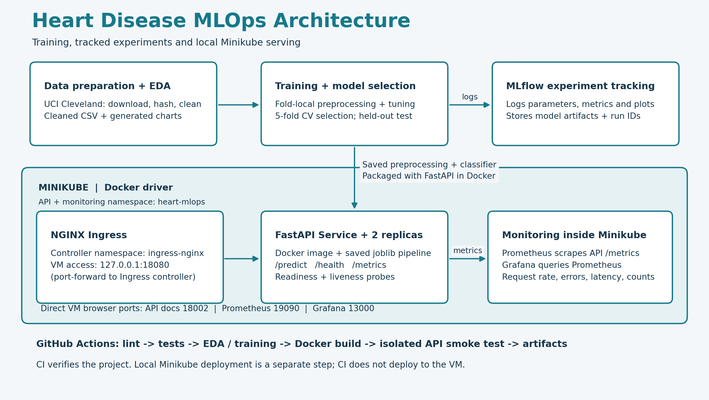

# Heart Disease MLOps Assignment

Educational end-to-end classification of UCI Cleveland heart disease labels. The 13 predictors plus target comprise 14 columns. This is not a clinically validated diagnosis or calibrated future-risk model.

## Evaluator prerequisites

Install Git and Python 3.12 or 3.13. For container and Kubernetes stages also install Docker Engine with Docker Compose (Linux), or Docker Desktop (macOS/Windows), and Minikube. Start Docker and confirm `docker info` works. Minikube uses the Docker driver and requires at least 2 available CPUs and 3 GB RAM in addition to the host's needs. Internet access is required for package and container downloads. Minikube supplies a matching kubectl through `minikube kubectl --`.

Use a Linux/macOS Bash terminal; on Windows use a configured WSL2 Linux environment. The commands below run independently of any personal VM automation script. Browser links refer to the computer running the services; for a remote VM, open the browser inside that VM.

```bash
git clone https://github.com/2025ae05588/ml-assignment1.git
cd ml-assignment1
```

## 1. Python setup, data, EDA, training and tests

```bash
python3 -m venv .venv
source .venv/bin/activate
python -m pip install --upgrade pip
python -m pip install -e .
python scripts/download_data.py
python scripts/eda.py
python scripts/train.py
ruff check .
pytest -q
uvicorn heart_ml.api:app --host 0.0.0.0 --port 8000
```

In another terminal:

```bash
curl http://localhost:8000/health
curl http://localhost:8000/predict -H 'Content-Type: application/json' --data @examples/patient.json
curl http://localhost:8000/metrics
```

Open http://localhost:8000/docs for the validated schema. `ca` and `thal` accept null; other fields are required. Confidence is the probability assigned to the predicted class, not a guarantee of correctness. Model artifacts use joblib; load only trusted artifacts.

The cleaned dataset is `data/processed/heart.csv`. The download script recreates it from the source; EDA plots are generated under `artifacts/`. Training writes the saved preprocessing/model pipeline to `artifacts/model.joblib`, metrics and CV results to `artifacts/`, and local MLflow tracking records. `notebooks/01_eda.ipynb` provides the notebook equivalent. The saved pipeline can be served without retraining; retrain to create your own MLflow history.

## 2. Experiment tracking

```bash
mlflow ui --backend-store-uri sqlite:///mlflow.db --host 127.0.0.1 --port 5000
```

Open http://localhost:5000. Seven tuning configurations are tracked, then the CV-selected model is evaluated once on the untouched 20% test split. EDA, CV tables, parameters, dataset hash, metrics and the full pipeline are logged. `artifacts/split.json` records exact row partitions. Training retains the evaluated training-only model rather than silently refitting on test data.

## 3. Container verification

Install Docker Desktop and start its engine. Then:

```bash
bash scripts/docker_verify.sh
```

This builds the image, starts it on port 8001, waits for health, checks prediction and saves real evidence under `artifacts/evidence/`. GitHub Actions also executes this check on Ubuntu.

## 4. Minikube: API, Prometheus and Grafana

From the repository root, after preparing the model:

```bash
bash scripts/deploy_local.sh
```

This builds the image and gives it a tag derived from its Docker content ID, starts the `heart-prayogshala` Docker-backed Minikube profile, loads that exact image, and applies a temporary API manifest referencing the content tag. Changed model artifacts therefore change the deployed image reference instead of reusing a cached fixed tag. The script waits for the NGINX controller and admission jobs before applying Ingress, retries transient admission failures, deploys monitoring, and waits for all deployments to become ready. The committed API manifest is not edited. Configurations are in `deployment/kubernetes.yaml` and `deployment/minikube/`. Monitoring runs inside Kubernetes. No personal screenshot runner is required.

Open four additional terminals from the repository root. Run one command per terminal and keep each running:

```bash
export KUBECONFIG="$PWD/deployment/kubeconfig"
minikube -p heart-prayogshala kubectl -- -n heart-mlops port-forward service/heart-api 18002:80
```

```bash
export KUBECONFIG="$PWD/deployment/kubeconfig"
minikube -p heart-prayogshala kubectl -- -n heart-mlops port-forward service/prometheus 19090:9090
```

```bash
export KUBECONFIG="$PWD/deployment/kubeconfig"
minikube -p heart-prayogshala kubectl -- -n heart-mlops port-forward service/grafana 13000:3000
```

```bash
export KUBECONFIG="$PWD/deployment/kubeconfig"
minikube -p heart-prayogshala kubectl -- -n ingress-nginx port-forward service/ingress-nginx-controller 18080:80
```

Verify from another terminal:

```bash
curl --fail http://127.0.0.1:18080/health
curl --fail http://127.0.0.1:18080/predict -H 'Content-Type: application/json' --data @examples/patient.json
curl --fail http://127.0.0.1:18002/metrics
```

Open these pages in the browser:

| Evidence | URL or terminal command |
|---|---|
| API schema and interactive prediction | http://127.0.0.1:18002/docs |
| Ingress health | http://127.0.0.1:18080/health |
| Prometheus target UP | http://127.0.0.1:19090/targets |
| Grafana dashboard | http://127.0.0.1:13000/d/heart-api/heart-api-operations |
| Kubernetes workloads | `minikube -p heart-prayogshala kubectl -- -n heart-mlops get deployments,pods,services,ingress` |
| Kubernetes Dashboard | `minikube -p heart-prayogshala dashboard --url` (open the printed URL) |

For kubectl and Dashboard commands, export `KUBECONFIG="$PWD/deployment/kubeconfig"` first. In Swagger expand POST `/predict`, select **Try it out**, paste `examples/patient.json`, and select **Execute**. Send several predictions, wait at least 10 seconds, and refresh Grafana with the time range **Last 15 minutes**. A LoadBalancer external IP may remain pending: the commands above access the API through port-forwarded Ingress without requiring `minikube tunnel`.

To stop: Ctrl+C in the port-forward/Dashboard terminals, then `minikube -p heart-prayogshala stop`. Restart with the deployment script. Delete the profile only when no longer needed: `minikube -p heart-prayogshala delete`. Cluster credentials in `deployment/kubeconfig` are excluded from Git.

## 5. Alternative monitoring with Docker Compose

```bash
docker compose -f deployment/compose.yaml up --build -d
```

Monitoring API: http://localhost:8002; Prometheus: http://localhost:9090; Grafana: http://localhost:3000. Provisioning loads the Heart API dashboard automatically. Default Grafana admin credentials are for local demonstration only; change before public exposure. The monitoring API uses port 8002 to avoid conflicting with the standalone API. Request logs contain method, bounded route name, status and duration, without patient payloads. Metrics provide request rate, 5xx errors and latency; no data-drift or clinical-performance monitoring is claimed.

## 6. CI verification

The workflow lints, tests, trains, logs experiments, builds Docker and smoke-tests the API. Failed commands stop the job. Artifacts are uploaded even on failure. Deployment is a documented local Kubernetes step; CI does not have credentials to deploy to a cluster automatically.

Repository: https://github.com/2025ae05588/ml-assignment1. GitHub Actions executes when the project is pushed. The local kind cluster and Compose stack are independently verified; their evidence is in artifacts/evidence/.

## Data and reproducibility

Source: https://archive.ics.uci.edu/dataset/45/heart+disease
Citation: Janosi, Steinbrunn, Pfisterer & Detrano (1989), Heart Disease, UCI Machine Learning Repository, DOI 10.24432/C52P4X, CC BY 4.0.
Original categories are retained: cp=1..4, slope=1..3, thal=3/6/7, ca=0..3. `?` is missing. Target num=0 is absence; 1..4 is presence. Cleaning removes exact duplicates, validates categories and preserves missing predictors for fold-local imputation. Numerical columns are median-imputed and standardized; categorical columns are mode-imputed and one-hot encoded. Random seed is 42. Model selection uses five-fold mean ROC-AUC, with accuracy, precision and recall also logged.

The small historical sample has limited representativeness. Test metrics have substantial sampling uncertainty, and probabilities have not been calibrated. Read and understand every component, personalize the experimental choices, and follow your course's AI-assistance policy before submission.

## Deliverables and evidence

- `src/`, `scripts/`, `tests/`: processing, models, serving, verification.
- `data/`: original source, cleaned CSV and provenance.
- `artifacts/`: plots, model, CV tables, split and metrics.
- `.github/workflows/ci.yml`: executable CI and container validation.
- `deployment/`: Kubernetes and monitoring configuration.
- `screenshots/`: locally observed API/training evidence; capture actual remote CI and Kubernetes screens after running them.

Previously recorded evidence includes successful remote CI, Docker serving, kind Ingress and Compose monitoring. These files describe past runs; services must be started again on a new machine. Genuine browser screenshots are included. Report and video deliverables are prepared separately.

## Verified kind deployment (current environment)

Docker Desktop is installed at `/Applications/Docker.app`. If its tools are outside your PATH:

```bash
export PATH="/Applications/Docker.app/Contents/Resources/bin:$PATH"
KIND_BIN=scripts/kind bash scripts/deploy_kind.sh
```

Install kind from https://kind.sigs.k8s.io/docs/user/quick-start/ on a fresh computer; the downloaded local executable is excluded from Git. The kind configuration maps its Ingress to http://127.0.0.1:8080. This route is verified with two ready API replicas. The LoadBalancer Service has no external IP on kind; Traefik Ingress provides the working access path. To inspect:

```bash
kubectl --kubeconfig deployment/kubeconfig -n heart-mlops get deployments,pods,services,ingress
curl http://127.0.0.1:8080/health
curl http://127.0.0.1:8080/predict -H 'Content-Type: application/json' --data @examples/patient.json
python scripts/verify_services.py
```

The kubeconfig is excluded from Git because it contains cluster credentials. To stop the demo services when finished: `docker compose -f deployment/compose.yaml down`. Delete the demo cluster with `kind delete cluster --name heart-assignment` only when you no longer need it.

## Screenshot evidence

Existing screenshots are in `screenshots/`. EDA and evaluation charts are generated automatically in `artifacts/`; they do not need to be photographed. For a new execution, manually capture the MLflow run table and selected run, passing tests, Docker build/container output, Kubernetes ready workloads, API prediction/health, Prometheus targets, Grafana dashboard, and a successful GitHub Actions run. Save new captures in `screenshots/` with descriptive names. New Prayogshala VM captures must be supplied by the person running that VM; existing images are not automatically evidence of a new run.

## Current execution evidence

The submitted model, metrics and VM screenshots correspond to MLflow run `cab705edb7524048a8ad5b31be8316c4`. See the [screenshot index](screenshots/README.md) for the complete supplied capture set. The [GitHub Actions screenshot](screenshots/github-actions-success.png) records successful [run 39255010564](https://github.com/2025ae05588/ml-assignment1/actions/runs/39255010564) for commit `3042161`, including tests, training, container verification and artifact upload. This is remote CI evidence; the other captures document the Prayogshala VM execution.

## Architecture diagram



The diagram distinguishes training/model selection from MLflow tracking and shows the API, NGINX Ingress and monitoring inside Minikube. Port `18080` is local access through a port-forward to the Ingress controller. Rebuild the PNG and SVG with `python scripts/build_architecture.py`.
